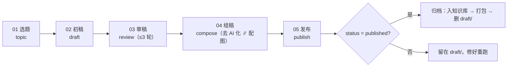

# penbot

脚本驱动的写作管线集合：把「一篇文章从选题到投递」拆成五个阶段、十三个流程节点，
机械流程全部由 Node 脚本编排，**只在需要判断的环节调用模型**。

当前实现 `wechat-article`（微信公众号文章）；`micro-news`（微新闻）、`web-novel`（网络小说）
仍在规划中，配置与入口目录尚未建立。

---

## 1. 背景与应用场景

### 为什么是脚本，不是 agent

agent 自我编排的常见问题是流程不可复现、token 开销大、失败后难以定位。这里把职责切开：

| 交给脚本 | 交给模型 |
| --- | --- |
| 阶段顺序、产物落盘、断点续跑、存在性判定 | 选题候选、择一与定类（判断模型）、纲要、初稿、修正、评稿、去 AI 化 |
| 字数 / 数字 / 重叠率等确定性闸门 | —— |
| 外部调用、留痕、重试、降级、归档 | —— |

失败只按两层处理，运行时不做自我修复：单次返回不合格 → 带失败原因改措辞重试（改好的提示词
由人写回 `prompts/*.yaml`）；某步最终缺必要输出物 → **中断并记日志**，不拿兜底值往下跑。
唯一例外是 04 的两条分支（去 AI 化 / 配图），它们失败只降级、不阻塞。

### 典型场景

- **知识库驱动日更**：候选主题从本地目录（或 WeKnora 远程库）里选，查重清单 = 已发布 + 在写的文章。
- **算力不出门**：写作 / 评稿 / 去 AI 化走自建网关上的本地模型，判断走 System One 协议端点。
- **无人值守**：`npm run pipeline` 处理完当前积压即退出（交给定时任务调度）；需要常驻监听用 `npm run pipeline:watch`，inbox 素材进来自动起稿，写不完续跑，发布后归档。
- **可审计**：每步一份 `NN-result.json`，每次外部调用的请求 / 响应落在 `NN-step/api/`（密钥不落盘）。

真实全跑一篇约 **20 分钟**（审稿循环占大半）；`--mock` 秒级跑通全流程。

## 2. 工作流程



- 每步对外唯一契约是 `NN-result.json`（信封 `stage / generated_at / title / type / files`）：
  `title`、`type` 只在 01 产生，之后逐步顺延；**后面要读前面的文件，只从 `files` 取路径**，没有 `state.json`。
- 续跑靠**产物存在性**决定起点，重跑覆盖同一路径（文件名不带时间戳）；`--stage <name>` 可提前停在某阶段。
- 模型不可用 / 外部服务故障只降级到对应能力；必要输出物缺失才中断。

## 3. 主要脚本

### 主入口 `scripts/wechat-article.mjs`

```bash
node scripts/wechat-article.mjs <command> [options]   # 等价：npm run wechat-article -- <command>
```

启动顺序固定：`parseArgs` → `loadDotEnv`（根目录 `.env`）→ `loadConfig`（defaults → models → 类型注册表 → `types/*.yaml` → steps）→ 命令分发。

> `<command>` 是**位置参数**，不能写成 `--auto`：以 `--` 开头会被当成选项，命令为空时只打印帮助。

| 类别 | 命令 | 作用 |
| --- | --- | --- |
| 三个入口 | `auto` | 知识库自动选题 → 判断模型定类 → 自动纲要 → 一路写下去 |
| | `manual` | 给定标题（`--title`），提纲可选（`--outline-file` / `--outline`） |
| | `post` | 给定草稿（`--file`），只做后期：审稿 → 组稿 → 发布 |
| 分步 | `topic` / `draft` / `review` / `compose` / `publish` | 单跑某阶段，产物追加进同一篇文章目录（`--article <slug>`） |
| 查看 | `steps` / `topics` / `kbs` | 看节点与配置、生成候选主题、列远程知识库 |
| 诊断 | `validate` / `doctor` / `classify` | 校验配置 / 检查服务连通性 / 只用判断模型定类 |

常用参数：`--type`、`--article`、`--stage`、`--mock`、`--rounds`、`--images`、`--de-ai-level`、
`--dry-run`；完整清单见 `--help` 与 [USAGE.md](docs/wechat-article/USAGE.md)。

### 无人值守编排器 `scripts/wechat-article-pipeline.mjs`

```bash
npm run pipeline        # 默认一次性：处理完当前 inbox 积压 + 一轮 draft 巡检即退出，交给定时任务（cron / 任务计划程序）调度
npm run pipeline:watch  # 常驻监听：inbox 素材进来自动起稿，写不完的续跑（Ctrl+C 退出）
```

- 轮询 `BASE_INBOX_FOLDER/wechat-article/*.md`：判断模型分成「标题素材 / 草稿素材」→ 分别走
  `manual` / `post`，一建出 `draft/<slug>/` 就删 inbox 原稿（不配该变量 = 关闭 inbox）。
- 巡检 `draft/`：按产物接力 `auto --article <slug> --stage <阶段>`；每阶段子进程独立超时，
  超时 kill 后下轮按上一步产物续跑；连续失败 / 无进展达 `max_fails` 次才跳过。
- 阈值与分类文案单源 `defaults.yaml` 的 `pipeline` 段；细节见
  [USAGE「无人值守编排器」](docs/wechat-article/USAGE.md)。

### npm 脚本

| 脚本 | 说明 |
| --- | --- |
| `npm run wechat-article -- <command>` | 主入口（`--` 后接命令与参数） |
| `npm run pipeline` | 无人值守编排器（默认一次性，处理完积压即退出） |
| `npm run pipeline:watch` | 无人值守编排器常驻监听模式 |
| `npm run wechat-article:validate` | 校验配置：节点词汇、handler、依赖、类型覆盖引用 |
| `npm run wechat-article:doctor` | 检查环境与节点里出现的所有模型 / 服务连通性 |
| `npm run lint` / `npm run check` | 代码合规检查 / 开发自检（lint → validate → 单测；测试脚本不在本文范围） |

首次使用：`npm install` → 根目录自建 `.env`（不入库）→ `npm run wechat-article:validate` → `npm run wechat-article:doctor` → `node scripts/wechat-article.mjs auto --mock` 跑通再说真发。

## 4. 各阶段概览

| 阶段 | 节点 | 对外产物 | 完成判据 | 失败策略 | 细节 |
| --- | --- | --- | --- | --- | --- |
| 01 选题 `topic` | `select_topic` → `classify_type` → `gather_materials` | `01-result.json` + `01-step/` | 文件存在 | 检索失败只 warn；定类失败落 `default_type` | [01_topic_step.md](docs/wechat-article/01_topic_step.md) |
| 02 初稿 `draft` | `outline` → `bundle_draft_input` → `draft_writing` | `02-result.json` + `02-step/` | 文件存在 | 初稿失败降级为分节生成 | [02_draft_step.md](docs/wechat-article/02_draft_step.md) |
| 03 审稿 `review` | `review` → `revision` → `scoring`（循环） | `03-result.json` + `reviewed.md` | 文件存在 | 字数重试耗尽 → **中断**；核稿不可用只让候选为空 | [03_review_step.md](docs/wechat-article/03_review_step.md) |
| 04 组稿 `compose` | `de_ai` ∥ `image_generation` | `04-result.json` + `composed.md` | `composed.md` 存在 | 两条分支各自只降级 | [04_compose_step.md](docs/wechat-article/04_compose_step.md) |
| 05 发布 `publish` | `publish` → `archive` | `05-result.json` + `final.md` / `final.html` / zip | `status` 与 `archive` 块 | 未真实成功就留在 `draft/`，修好可重跑 | [05_publish_step.md](docs/wechat-article/05_publish_step.md) |

## 5. 配置与外部依赖

| 文件 | 管什么 |
| --- | --- |
| `.env`（不入库） | 服务地址 / 密钥 + 运行时旋钮（`${PB_*}`） |
| [`config/models.yaml`](config/models.yaml) | 唯一模型表（`llm.*` / `systemone.*`），端点级默认 |
| [`config/wechat-article/defaults.yaml`](config/wechat-article/defaults.yaml) | 输出目录、类型共享默认（审稿 / 检索 / 配图 / 发布 / 编排器） |
| [`config/wechat-article/steps/`](config/wechat-article/steps/) | 流程节点：模型调用、提示词 / 契约 id、开关与档位、产物声明 |
| [`config/wechat-article/prompts/`](config/wechat-article/prompts/) | 提示词全文（含给模型看的输出结构说明） |
| [`config/wechat-article/schemas/`](config/wechat-article/schemas/) | 输出校验契约（只给脚本用，不渲染进提示词） |
| [`config/wechat-article/types/`](config/wechat-article/types/) | 文章类型：字数、评分维度、配图区间、风格、选题窗口 |

外部服务较多，下表只说明「缺了怎么降级」，**实际可用性以你的 `.env` 与网络为准，仅供参考**：

| 能力 | 服务 | 缺了会怎样 |
| --- | --- | --- |
| 写作模型 | Ollama / 自建网关 | 必需项，写作与评稿都靠它 |
| 判断模型 | System One 协议端点 | 定类落 `default_type`，审稿去留回退分数规则 |
| 知识库 | 本地目录 / WeKnora | 只用本地目录 |
| 外部检索 | opencode `websearch` 工具节点 | 只用本地素材 |
| 核稿 | correct-cn 两规则端点 | 候选为空，循环照常 |
| 配图 | ModelScope（主）→ Pollinations（兜底） | 保留 / 注释图片标记，不阻塞 |
| 邮件 | Resend | 不投邮件 |
| 公众号草稿 | `@wenyan-md/cli` | 不投草稿 |

变量清单、开关与阈值默认值统一见 [USAGE 环境变量节](docs/wechat-article/USAGE.md)。

## 6. 延伸阅读

- [AGENTS.md](AGENTS.md) — 工程约定：编排策略、配置单源、产物布局、留痕命名（改代码前先读）
- [docs/wechat-article/USAGE.md](docs/wechat-article/USAGE.md) — 完整命令参考与逐项配置说明
- `docs/wechat-article/01_topic_step.md` … `05_publish_step.md` — 分阶段执行序列、节点表、排障
- [docs/wechat-article/artifacts.md](docs/wechat-article/artifacts.md) — 目录布局、信封、续跑、发布判定
- 设计取舍：[topic-selection.md](docs/wechat-article/topic-selection.md) ·
  [web-search.md](docs/wechat-article/web-search.md) ·
  [materials-collection.md](docs/wechat-article/materials-collection.md)
