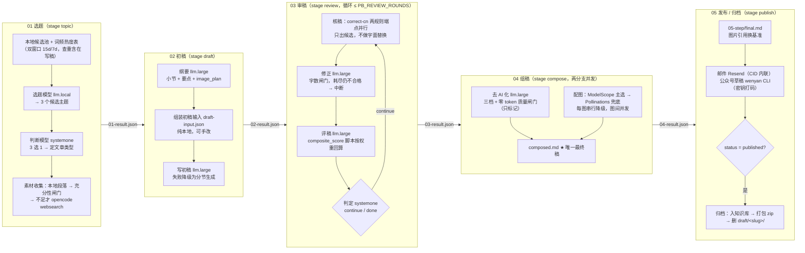

# penbot

脚本驱动的写作管线集合：把「一篇公众号文章从选题到投递」拆成五个阶段、十三个流程节点，
机械流程全部由 Node 脚本编排，**只在需要判断的环节调用模型**。

当前实现的管线：`wechat-article`（微信公众号文章）。规划中的两条：`micro-news`（微新闻）、`web-novel`（网络小说），
配置与入口目录尚未建立。

---

## 1. 背景与应用场景

### 为什么是脚本而不是 agent

让大模型「一条龙」写文章的常见做法是 agent 自我编排：流程不可复现、token 开销大、失败后难以定位。
本项目的取舍是反过来的——

| 交给脚本 | 交给模型 |
| --- | --- |
| 阶段顺序、产物落盘、断点续跑、存在性判定 | 选题（3 候选）、择一与定类（判断模型）、纲要、初稿、修正、评稿、去 AI 化 |
| 字数/数字/重叠率等**确定性闸门** | —— |
| 服务调用、留痕、重试、降级、归档 | —— |

判断模型（`systemone`）只回答「选哪个 / 要不要再改」这类离散问题，写作模型只负责成文，
两者都不能改流程。**失败只按两层处理，不做运行时自我修复**：
单次返回不合格 → 带失败原因改措辞重试（落地仍要人工把改好的提示词写回 `prompts/*.yaml`）；
某步最终缺必要输出物 → **中断流程 + 记录日志**，不静默用兜底值继续跑。
唯一例外是 04 的两条分支（去 AI 化 / 配图），它们失败只降级、不阻塞——那是设计好的降级。

### 典型用法

- **知识库驱动日更**：候选主题从本地 Obsidian 目录（或 WeKnora 远程库）里选，查重清单 = 已发布 + 在写的文章。
- **算力不出门**：写作/评稿/去 AI 化默认走自建网关上的本地模型（`llm.large` = 35b），一次判断/二次判断走 System One 协议端点。
- **无人值守**：运行开关与阈值全部写成 `${PB_*:-默认值}`，只改 `.env`，配置文件不动；跑完自动投邮件 + 公众号草稿并归档。
- **可审计**：每步一份 `NN-result.json`（对外契约）+ `NN-step/api/` 里每次外部调用的请求/响应留痕（密钥一律不落）。

### 成本与耗时（真实全跑，非 mock）

`01 → 05` 一篇约 **20 分钟**：大头是审稿循环 3 轮（约 8.5 分钟）与去 AI 化的质量重调；
外部检索按组并行、单组 40–170s，只在本地素材不足时出门。配图主通道单张 10–45s。

---

## 2. 工作流程

```
选题 + 资料收集 ──► 纲要 + 初稿 ──► 核稿/修正/评稿/判定(≤3 轮) ──► 组稿(去 AI 化 ∥ 配图) ──► 邮件 + 公众号草稿 → 归档
      01 topic          02 draft              03 review                  04 compose                05 publish
```



### 五步一览

| 步 | stage | 节点 | 对外产物 | 完成判据 | 失败策略 |
| --- | --- | --- | --- | --- | --- |
| 01 选题 | `topic` | `select_topic` → `classify_type` → `gather_materials` | `01-result.json`（+ `01-step/topic.md`、`proposal.json`、`sources/`） | 文件存在 | 检索失败只 warn；定类失败落 `default_type` |
| 02 初稿 | `draft` | `outline` → `bundle_draft_input` → `draft_writing` | `02-result.json`（+ `outline.json`、`draft-input.json`、`draft.md`） | 文件存在 | 初稿模型失败降级为分节生成 |
| 03 审稿 | `review` | `review` → `revision` → `scoring`（循环） | `03-result.json` + `03-step/reviewed.md` | 文件存在 | 字数重试耗尽 → **中断**；核稿服务不可用只让候选为空 |
| 04 组稿 | `compose` | `de_ai` ∥ `image_generation` | `04-result.json` + `04-step/composed.md` | `composed.md` 存在（`polished.md` 只是分支进度） | 两条分支各只降级：退回审稿稿 / 保留标记 |
| 05 发布 | `publish` | `publish` → `archive` | `05-result.json`（+ `final.md`、`final.html`、`published/*.zip`） | `status` 与 `archive` 块 | 未真实成功就留在 `draft/`，修好可重跑 |

> 每步的 `NN-result.json` 共用一个信封（`stage / generated_at / title / type / files`），
> `title` 与 `type` 只在 01 产生、之后逐步顺延；**后面任何一步要读前面的文件，只从 `files` 取路径**。
> 02–05 只读上一步的 result 作为输入，没有 `state.json`。

---

## 3. 主入口

```bash
node scripts/wechat-article.mjs <command> [options]     # 等价：npm run wechat-article -- <command>

node scripts/wechat-article.mjs auto   --mock            # 不发真实请求跑通 01→05
node scripts/wechat-article.mjs review --article my-article-slug
```

> **`<command>` 是位置参数，不能写成 `--auto`。** `parseArgs` 把任何以 `--` 开头的参数当选项，
> 所以 `node … --auto` 会让命令为空、**只打印帮助后退出**（不报错、也不跑管线）。命令名一律
> **不带 `--`**：`auto` / `run` / `manual` / `post` / `topic` / `draft` / `review` / `compose` / `publish` …。

入口只有一个文件（`scripts/wechat-article.mjs`，约 3500 行），启动顺序固定：
`parseArgs` → `loadDotEnv(项目根/.env)` → `loadConfig`（defaults → models → article-types → types/*.yaml → steps）→ 命令分发。
阶段名单源是入口的 `PIPELINE_STAGES = topic|draft|review|compose|publish`，
可跳过节点名单源是 `SKIPPABLE_STEPS = de_ai|image_generation|publish|archive`；两者同时是 `validate` 校验配置词汇表的依据。

### 命令

| 类别 | 命令 | 作用 |
| --- | --- | --- |
| **三个入口** | `auto` | 入口 1·全自动：知识库自动选题 → 判断模型定类 → 自动纲要 → 一路往下写 |
| | `manual` | 入口 2·给定标题：`--title` 必填；提纲可选（`--outline-file` / `--outline`，给了按提纲写，不给则收集资料后由模型生成） |
| | `post` | 入口 3·给定草稿：`--file <稿件.md>` 导入一篇外部草稿，只做后期处理（审稿修正 → 润色 → 配图 → 发布），标题取自 frontmatter/一级标题/`--title` |
| | `run` | 完整管线（等价 `auto`，保留兼容） |
| **分步** | `topic` / `draft` / `review` / `compose` / `publish` | 各阶段单跑，都在同一篇文章目录里追加产物；`--article <slug>` 指定（只有一篇时可省略） |
| **查看** | `steps` | 列节点、handler、模型调用、产物；`--type <id>` 看类型覆盖后的配置；`--step <name>` 看单节点最终提示词 |
| | `topics` | 列候选文章；`--count N --output <目录>` 生成 N 个候选主题（含提纲）的 Markdown |
| | `kbs` | 列 WeKnora 知识库（取 `kb_ids`） |
| **诊断** | `validate` | 校验配置（`--input <file>` 同时校验初稿输入） |
| | `doctor` | 检查环境与**所有**节点里出现的模型/服务的连通性 |
| | `classify` | 只用判断模型按「标题 + 提纲」定类，打印得分 |

入口与分步之后完全一致：任何入口都可以用 `--stage <name>` 提前停在某个阶段，
续跑靠**产物存在性**决定起点（`detectStartStage`），重跑覆盖同一路径、不带时间戳。

### npm 脚本

| 脚本 | 命令 |
| --- | --- |
| `npm run wechat-article` | 管线入口（`--` 后接命令与参数） |
| `npm run pipeline` | 无人值守编排器（常驻：inbox 素材监听 + draft 巡检续跑，spawn 管线入口；详见 USAGE「无人值守编排器」） |
| `npm run wechat-article:validate` / `:doctor` | 配置校验 / 环境检查 |
| `npm run lint` / `lint:fix` | 代码合规检查 / 就地修可修项 |
| `npm run check` | lint → validate → 全量单测 |
| `npm test` | 全量测试 |
| `npm run test:topic` `test:sources` `test:outline` `test:draft` `test:review` `test:compose` `test:publish` `test:steps` `test:infra` | 按阶段跑 |

在 OpenCode 里也可以用斜杠命令 `/wechat-article <参数>`（见根目录 `opencode.json`）——
opencode 只作为**工具节点**（`websearch`）被脚本调用，不作为编排器。

### 常用参数（完整清单见 `--help` 与 [USAGE.md](docs/wechat-article/USAGE.md)）

| 组 | 参数 |
| --- | --- |
| 输入 | `--type <id>`（仅作定类失败时的回退）· `--topic` · `--title`（manual/post）· `--outline-file` / `--outline`（manual，可选）· `--requirements` · `--article` · `--file`（分步指定稿件；post 的草稿源）· `--slug` · `--input` · `--topic-file` · `--sources-file` · `--from-proposal` |
| 运行 | `--stage topic\|draft\|review\|compose\|publish` · `--mock` · `--verbose` · `--rounds` · `--length-attempts` · `--images 1-5` · `--de-ai-level light\|standard\|deep` · `--knowledge-source local\|weknora\|both` · `--config/--defaults/--models/--steps`（换配置根） |
| 发布 | `--email/--no-email` · `--wechat/--no-wechat` · `--to` · `--dry-run` · `--auto-publish` |
| 遗留 | `--model` / `--review-model`：全局覆盖模型 profile，节点配置才是单源，后续清理 |

### 无人值守编排器（`npm run pipeline`）

`scripts/wechat-article-pipeline.mjs` 是常驻进程，**只 spawn 主入口、不 import 它**（lint 规则只允许
comm 模块被主入口引用；子进程也天然给出「超时 kill」的边界）。两条节奏、单并发：

- **inbox 监听**：`BASE_INBOX_FOLDER/wechat-article/*.md` 里的新素材，判断模型分成「标题素材 /
  草稿素材」→ 分别走 `manual --topic …` / `post --file …`；一建出 `draft/<slug>/`（进入流转）
  就删原稿。**`BASE_INBOX_FOLDER` 不配 = 关闭 inbox，仅做 draft 巡检**。
- **draft 巡检**：每 `PB_PIPELINE_INSPECT_MS`（默认每小时）对 `draft/` 下未完成的文章按产物
  接力 `auto --article <slug> --stage <阶段>`，每阶段子进程带自己的超时（`PB_TIMEOUT_*_MS`），
  超时 kill 后下一轮按上一步产物续跑；连续失败/无进展达 `PB_PIPELINE_MAX_FAILS`（默认 3）次才跳过。

```bash
npm run pipeline        # 前台常驻（Ctrl+C 退出）；用 systemd / 计划任务托管时仍是这一条命令
```

子进程输出直接转发到终端；每篇文章自己的文本日志仍在 `draft/<slug>/logs/pipeline.log`。
阈值/开关全部单源 `defaults.yaml` 的 `pipeline` 段（见 §6），细节见
[USAGE「无人值守编排器」](docs/wechat-article/USAGE.md)。

---

## 4. 各阶段细节（表 + 地图）

一句话流程 + 关键闸门写在下面，**逐步细节（执行序列、节点表、产物地图、开关、排障）在分步文档里**：

| 步 | 分步文档 | 一句话 |
| --- | --- | --- |
| 01 | [01_topic_step.md](docs/wechat-article/01_topic_step.md) | 双窗口挑候选、一次模型出 3 个主题、判断模型择一并定类、素材收齐（不足才出门检索） |
| 02 | [02_draft_step.md](docs/wechat-article/02_draft_step.md) | 纲要 → **可手改的** `draft-input.json` → 初稿；篇幅不在这里调 |
| 03 | [03_review_step.md](docs/wechat-article/03_review_step.md) | 每轮核稿→修正→评稿→判定；`check` 只管要不要再改一轮，`passed` 只看分数阈值 |
| 04 | [04_compose_step.md](docs/wechat-article/04_compose_step.md) | 去 AI 化与配图并发；`composed.md` 是唯一最终稿；两条分支失败只降级 |
| 05 | [05_publish_step.md](docs/wechat-article/05_publish_step.md) | 落 `final.md` → 邮件 + 公众号草稿 → 只有真投递成功才入库打包删目录 |

### 01 选题（`topic`）

- **候选池**：按 `topic.candidate_days`（文件日期大样本）/ `fresh_days`（采集日期小样本）扫本地知识库目录，本地算词频热度表（零 token）。
- **一次模型调用**出 3 个候选主题（`title / thesis / angle / rationale / keywords / source_hints / score`），再用判断模型 3 选 1；置信度低于 `escalate_below` 自动升级二次判断模型。
- **查重**：提示词里带上「已发布 + 正在写」的文章清单，避免重复选题。
- **素材**：本地段落按命中排序截取（`PB_KNOWLEDGE_MAX_SOURCES` 条上限），充分性闸门四条判据（命中数 / 摘录字数 / `source_hints` 覆盖率 / 新鲜度）判不足时才走 opencode `websearch`。
- 定类在选题**之后**（`auto` 入口），所以 `--type` 只是判断模型失败时的回退。

### 02 初稿（`draft`）

- 纲要输出小节 + 要点 + **`image_plan`**（配图计划：位置、描述、张数依据）。
- `02-step/draft-input.json` = 标题 + 大纲 + 相关资料 + 类型要求，**可以手改**后 `draft --input` 再写；`validate --input` 先校验（硬错误 + 软警告逐条列出）。
- 初稿一次调用写完；失败降级为按小节逐节生成，产出同一形状的 `draft.md`。
- 正文只留**裸 `[[img:N]]`** 标记（说明文字不进正文，字数统计排除标记）。

### 03 审稿（`review`）

| 环节 | 关键口径 |
| --- | --- |
| 核稿 | correct-cn 两规则端点并行，**只采集候选**：错别字候选交给修正模型逐条核实，敏感词只留痕、从不进提示词 |
| 修正 | 首轮依据核稿候选，第二轮起叠加上一轮评分与 `must_fix`；返回稿本地计字，不合格带原因重试（`--length-attempts`，默认 3），**耗尽仍不合格 → 中断管线** |
| 评稿 | `composite_score` 由**脚本按维度权重回算**；模型自报 `total` 只以 `reported_score` 留痕（偏差 >5 记警告）。每条分数带 `scorer` / `scorer_model`——不同模型的分是不同量纲 |
| 判定 | 判断模型答 `continue/done`，只决定「要不要再来一轮」；不可用时回退 `composite_score >= pass_score` 规则 |

`passed` = 最后一轮 `composite_score >= pass_score`，与轮次上限 `PB_REVIEW_ROUNDS`（默认 3）都是确定性判定。
审稿阶段重跑会先清掉旧留痕，避免上一次中断运行的文件冒充本次。

### 04 组稿（`compose`）

- **两条分支并发**（`Promise.all`）：去 AI 化只读 `reviewed.md`，配图只读 `outline.json` 的 `image_plan`。
- **去 AI 化三档**：`light` 只换词（默认）/ `standard` 改到句子 / `deep` 整篇重述，各档自带提示词 id 与原稿逐字重叠上限（0.85 / 0.50 / 0.35）。
  质量闸门**零 token、只标记不阻塞**：重叠率、字数区间、原稿数字全部保留；不合格换采样重调，耗尽后取最接近合格的一版。
- **配图**：张数优先级 `--images` > 纲要规划 > 类型 `image_count.default` > `min`（始终 clamp 到 min~max）；
  每张图内部 `primary`(ModelScope) → `fallback`(Pollinations) **串行降级**，图与图之间按 `PB_IMAGE_CONCURRENCY` 并发；
  落盘扩展名跟随响应 `content-type`。
- `polished.md` **只在真出润色稿时落盘**（关档与失败回退都不写，`files.polished` 记 `null`）；`composed.md` 才是终稿。

### 05 发布 / 归档（`publish`）

- 终稿从 `composed.md`（基准=文章根）挪进 `05-step/final.md`（基准=`05-step/`）时，正文图片引用**同步换基准**，否则 wenyan CLI 与邮件 CID 都找不到图。
- 渠道开关分三层，单源都在 `steps/50-publish.yaml` 的 `publish` 节点：`enabled`（整环节）> `handler_options.auto_publish`（落稿但不投递）> `handler_options.email` / `wechat`（单渠道）；`--auto-publish` / `--email` / `--wechat` 临时覆盖；`--mock` 运行按演练处理（不调外部投递）。
- `status` 只有 `published`（启用渠道全部成功）才触发归档；`partial` / `failed` / `dry_run` / `skipped` 都留在 `draft/`。
- 归档序列：写清单 → 打包 → 删目录（知识库入库失败只记录，不阻塞打包；`knowledge_dir` 留空 = 跳过入库）。

### 一篇文章的目录地图

```
$BASE_OUTPUT_FOLDER/                     默认 output/wechat-article
├── draft/<slug>/                        一篇文章一个目录（目录名 = 标题 slug）
│   ├── 01-result.json ─┬─ 02-result.json ─┬─ 03-result.json ─┬─ 04-result.json ─┬─ 05-result.json
│   │   （每步对外唯一契约：信封 + 本步载荷 + validation）      │                  │
│   ├── 01-step/  topic.md · proposal.json · sources/*.md · web-search/*.md · api/
│   ├── 02-step/  outline.json · outline.md · draft-input.json · draft.md · api/
│   ├── 03-step/  round-<n>/{correct,after-correct,after-revise,score,check} · round-<n>-diff.md · reviewed.md · api/
│   ├── 04-step/  polished.md · images.json · composed.md · images/ · api/
│   ├── 05-step/  final.md · final.html · api/
│   └── logs/pipeline.log                全部文本日志（独立命令也写这里）
└── published/<YYYYMMDD>-<slug>.zip      发布成功后归档（含 05-result.json 清单）
```

`NN-step/api/` 留痕命名：`子步骤号_轮次(尝试)-label(_F).<模型|provider>.json`
（步骤号由目录名承担；轮次按 label 独立计数，换模型不重置；`(尝试)` = 本次调用内的重试；`_F` = 降级兜底调用）。
**留痕与日志绝不含 Authorization / API key 原文**，大 body 只记摘要。

> 编排器的 inbox 素材目录在 `BASE_INBOX_FOLDER/wechat-article/`（**不在文章输出目录里**）；
> 素材被路由进 `draft/<slug>/`（进入流转）后，inbox 原文件即删除。

---

## 5. 配置地图（哪个文件管什么）

| 文件 | 管什么 | 什么时候改 |
| --- | --- | --- |
| `.env`（不入库、不打印值） | 服务地址与密钥 + **所有运行时旋钮**（`${PB_*}`） | 日常只改这里 |
| [`config/models.yaml`](config/models.yaml) | 唯一的模型表：`llm.*`（local/small/large/remote）+ `systemone.*`（classifier/classifier-deep），端点级默认 | 换模型、调端点超时 |
| [`config/wechat-article/defaults.yaml`](config/wechat-article/defaults.yaml) | 输出目录、判断模型行为参数、类型共享默认（`review` / `knowledge` / `illustrations` / `publish`） | 换服务、调检索与配图默认 |
| [`config/wechat-article/steps.yaml`](config/wechat-article/steps.yaml) + `steps/10-topic.yaml` … `50-publish.yaml` | 流程节点：`models.<调用名> = { id, prompt / schema, options, rounds / levels }`、`enabled`、`handler_options`、`artifacts` | 调模型/超时/重试/档位、开关分支 |
| [`config/wechat-article/prompts/`](config/wechat-article/prompts/) | **提示词全文**（含给模型看的输出 JSON 骨架、按条件二选一的整句文案），id = `<文件>.<key>` | 调写作与判断行为 |
| [`config/wechat-article/schemas/`](config/wechat-article/schemas/) | 输出校验契约（紧凑 DSL），只被脚本用；`description` 给人看，**禁止渲染进提示词** | 改输出形状时与 prompts 两处同步 |
| [`config/wechat-article/article-types.yaml`](config/wechat-article/article-types.yaml) + [`types/`](config/wechat-article/types/) | 类型身份：字数区间、评分维度与权重、配图区间、风格、`topic` 窗口 | 新增/调整文章类型 |

三条硬规则（详见 [AGENTS.md](agents.md)）：

- **配置必须真驱动**：配置有了但代码没实现 = 补代码，不是删配置点；写了没人读的配置 = 说谎，删掉。
- **可变开关单源 `.env`**：`expandEnv` 替换出来是字符串，加载期必须归一（`toBool` / `toNumber`），代码里不留与配置同值的兜底默认；必填参数在**消费点**抛错并点名完整配置路径。
- **模型只在 `models.yaml` 定义**，steps 节点只引用 id；换模型不吃 `PB_MODEL_*` 别名（两处都能改同一个模型会互相掩盖）。

---

## 6. 环境变量

| 变量 | 用途 | 默认 |
| --- | --- | --- |
| `LOCAL_LLM_BASE_URL` / `LOCAL_LLM_BASE_MODEL` / `LOCAL_LLM_LARGE_MODEL` / `LOCAL_LLM_SMALL_MODEL` / `LOCAL_LLM_API_KEY` | 本地/网关模型（`llm.local` = 9b 选题，`llm.large` = 35b 写作与评稿） | `http://localhost:11434`，`qwen3.5:9b` / `qwen3.6:35b` |
| `PB_LLM_BASE_URL` / `PB_LLM_MODEL` / `PB_LLM_API_KEY` | 远程 OpenAI 兼容端点（`llm.remote`，`--model` 备选） | — |
| `SYSTEMONE_BASE_URL` / `SYSTEMONE_API_KEY` / `SYSTEMONE_MODEL1` / `SYSTEMONE_MODEL2` | 判断模型（一次 / 二次判断）；`base_url` 留空 = 按不可用降级 | `tev1` / `nimble` |
| `OPENCODE_DEFAULT_MODEL` | 外部检索（opencode `websearch` 工具节点）用的模型 | `ollama-local/qwen3.5:9b` |
| `PB_PYCORRECTOR_API_URL` / `PB_PYCORRECTOR_API_KEY` | correct-cn 核稿（`Authorization: Bearer`） | `https://correct-api.myehome.top` |
| `PB_MODEL_IMAGE_API_KEY` | ModelScope 配图主通道 | — |
| `PB_RESEND_API_KEY` / `PB_RESEND_FROM` | 邮件投递 | `penbot@myehome.cn` |
| `WECHAT_MP_APP_ID` / `WECHAT_MP_APP_SECRET` | 公众号草稿（spawn 时映射成 CLI 认的 `WECHAT_APP_ID` / `WECHAT_APP_SECRET`） | — |
| `WEKNORA_BASE_URL` / `WEKNORA_API_KEY` | 远程知识库 | — |
| `BASE_OUTPUT_FOLDER` | 文章根目录（自动建 `draft/` 与 `published/`） | `output/wechat-article` |
| `BASE_INBOX_FOLDER` | 编排器素材根目录：监听 `BASE_INBOX_FOLDER/wechat-article/*.md`；**留空 = 关闭 inbox，仅做 draft 巡检** | — |
| `KNOWLEDGE_PIPELINE_DIR` | 发布成功后终稿的待入库目录 | `D:/knowledge/pipeline` |
| `PB_ARTICLE_TYPE` | 默认类型 id（`--type` 优先；没设时交给判断模型） | — |
| **运行时旋钮** `PB_REVIEW_ROUNDS` · `PB_PASS_SCORE` · `PB_KNOWLEDGE_MAX_SOURCES` · `PB_USE_WEKNORA` · `PB_WEB_SEARCH_ENABLED` · `PB_IMAGE_CONCURRENCY` · `PB_DE_AI_ENABLED` · `PB_DE_AI_LEVEL` · `PB_IMAGES_ENABLED` | 审稿轮次 / 通过线 / 素材条数 / 远程库 / 外部检索 / 配图并发 / 去 AI 化开关与档位 / 配图开关 | 3 · **各类型自带**（78 或 82，见 `types/*.yaml`）· 8 · false · true · 2 · true · light · true |
| **编排器旋钮** `PB_PIPELINE_POLL_MS` · `PB_PIPELINE_INSPECT_MS` · `PB_PIPELINE_MAX_FAILS` · `PB_PIPELINE_CLASSIFY` · `PB_TIMEOUT_TOPIC_MS` · `PB_TIMEOUT_DRAFT_MS` · `PB_TIMEOUT_REVIEW_MS` · `PB_TIMEOUT_COMPOSE_MS` · `PB_TIMEOUT_PUBLISH_MS` | inbox 扫描间隔 / draft 巡检间隔 / 连续失败上限 / 素材分类开关 / 五阶段子进程超时（ms） | 15000 · 3600000 · 3 · true · 900000 · 1800000 · 2700000 · 1800000 · 600000 |

配置里支持 `${VAR}` 与 `${VAR:-默认值}` 展开。完整口径与例外清单见
[USAGE.md 的环境变量节](docs/wechat-article/USAGE.md)。

---

## 7. 依赖的服务（全部可单独开关）

| 能力 | 服务 | 关掉会怎样 |
| --- | --- | --- |
| 本地写作模型 | Ollama / 自建网关（只放 `/api/chat`、`/api/tags`） | 必需项：写作与评稿都靠它 |
| 判断模型 | System One 协议端点（兼容 TypeSafe Jev / vLLM `/v1/systemone`） | 定类落 `classifier.default_type`，审稿去留回退分数规则 |
| 知识库 | 本地目录（主）/ WeKnora（`PB_USE_WEKNORA`） | 只用本地目录 |
| 外部检索 | opencode `websearch` 工具节点（一次性生命周期，端口/进程显式回收） | 只用本地素材 |
| 核稿 | correct-cn（`/api/correct` + `/api/sensitive/check` 并行） | 候选为空，循环照常 |
| 配图 | ModelScope（主选）→ Pollinations（兜底） | `composed.md` 里保留/注释标记，不阻塞 |
| 邮件 | Resend | 不投邮件 |
| 公众号 | `@wenyan-md/cli`（已在 `package.json` 依赖里） | 不投草稿 |

缺哪个服务就降级或跳过对应能力，不会中断整条管线——**除了**必要输出物缺失（那是中断 + 记日志）。

---

## 8. 安装与自检

```bash
npm install                                  # yaml / markdown-it / @opencode/{cli,client} / @wenyan-md/cli
# 根目录自建 .env（不入库，仓库里没有模板）：变量清单见 §6，缺哪服务的密钥就跳过哪段能力

npm run check                                 # lint → validate → 全量单测，一条命令跑完三道闸门
npm run lint                                  # 代码合规检查（分层/风格/本仓库不变量，标准见 AGENTS.md）
npm test                                      # 全量单测（stub/mock，不发真实请求）
npm run wechat-article:validate               # 校验配置（节点词汇表、handler、依赖、类型覆盖引用）
npm run wechat-article:doctor                 # 检查环境与节点里出现的所有模型/服务连通性

# 不发真实请求跑通 01→05
npm run wechat-article -- auto --type ai-news --mock --stage publish

# 真实全跑（本地模型）
npm run wechat-article -- auto --type ai-news --stage draft
npm run wechat-article -- review  --article <slug>
npm run wechat-article -- compose --article <slug>
npm run wechat-article -- publish --article <slug> --email --wechat
```

「配置生效」由三处分别守住，口不一样、别指望一条命令查全部：

| 时机 | 负责代码 | 拦什么 |
| --- | --- | --- |
| 配置加载期 | `scripts/lib/steps.mjs#loadSteps` / `normalizeCalls` | 模板白名单外的参数、未知模型 id、非法取值、已废弃的扁平 `model`/`retry_limit`/`timeout`、多调用节点误写节点级 `prompt`/`schema`、`systemone` 调用写 `rounds`/`levels` |
| `npm run wechat-article:validate` | `validateConfig` + `validateSteps`（入口 `cmdValidate`） | 节点 `stage` 与 `skippable` 词汇、步骤名合法/不重复、`handler` 形式、`depends_on` 指向不存在的步骤、`result_schema` 挂在不落 `NN-result.json` 的节点或引用的条目没有可执行 DSL、类型层覆盖了未知步骤或不存在/无 DSL 的 `prompt`/`schema` id、给不可跳过节点写 `enabled`；另有软警告（未声明 `input_format`/`output_format`） |
| 运行期消费点 | `stepCallConfig` / `stepCallContract` / `pickPromptText` / `needConfig` | 有校验契约却没写 `retry_limit`、缺提示词文案 key、端点必填参数缺失——都在真正要用那一刻抛错并点名配置路径，代码不留同值副本 |

`prompts/`、`schemas/` 里**不许有无人引用的孤儿条目**这条不变量由测试
[tests/wechat-article/steps.test.mjs#L422](tests/wechat-article/steps.test.mjs#L422)
「真实注册表：提示词与数据结构 id 都被引用」守住，`validate` 不查它。

代码本身另有一道静态闸门：`npm run lint`（ESLint 10 flat config [eslint.config.mjs](eslint.config.mjs)
+ 本地插件 [scripts/lint/penbot-rules.mjs](scripts/lint/penbot-rules.mjs)）查分层依赖方向、
`.mjs` 扩展名、风格、以及两条本仓库不变量（留痕不许带鉴权字段、成句文案不许抄进代码）；
规则分层、豁免纪律与「为什么配置单源类不变量不进 lint」写在 [AGENTS.md](agents.md) 的「JS/mjs 代码规范」一节。
基线是 0 error / 0 warning，新增代码直接达标，不做「先容忍存量再收紧」。

---

## 9. 目录结构

```
penbot/
├── config/
│   ├── models.yaml                  全局唯一模型表（三管线共享）
│   └── wechat-article/              defaults / steps(+steps/) / prompts / schemas / types / article-types
├── scripts/
│   ├── lib/                         跨管线共享机制（config/steps 加载、模板渲染、模型客户端、知识检索、留痕…）
│   ├── comm/                        功能专属模块（wechat-publish、wechat-illustrate），只允许 comm → lib
│   ├── lint/penbot-rules.mjs        本仓库不变量的自定义规则（留痕无密钥、文案单源）
│   ├── wechat-article.mjs           管线入口（一管线一文件）
│   └── wechat-article-pipeline.mjs  无人值守编排器（inbox 监听 + draft 巡检，spawn 管线入口）
├── tests/wechat-article/            按阶段的测试 + helpers 夹具 + lint.test.mjs（规则与分层断言）
├── docs/wechat-article/             USAGE.md · 5 份 NN_*_step.md · artifacts / topic-selection / web-search / materials-collection
├── output/wechat-article/           运行产物（draft/ 与 published/，gitignored）
├── eslint.config.mjs                lint 分层规则（L1 分层 / L2 风格 / L3 不变量；L4 交给 validate + 单测）
├── opencode.json                    OpenCode 斜杠命令与只读写作代理
├── agents.md                        工程约定（编排策略、配置单源、产物布局、留痕命名）
└── package.json
```

## 10. 延伸阅读

- [AGENTS.md](agents.md) — 目录规范、编排失败处理、配置单源标准、steps 节点统一写法、产物与留痕口径（改代码前先读）
- [docs/wechat-article/USAGE.md](docs/wechat-article/USAGE.md) — 完整命令参考与逐项配置说明
- [docs/wechat-article/01_topic_step.md](docs/wechat-article/01_topic_step.md) … [05_publish_step.md](docs/wechat-article/05_publish_step.md) — 分阶段细节与排障
- [docs/wechat-article/artifacts.md](docs/wechat-article/artifacts.md) — 目录布局、信封、续跑规则、发布与归档判定
- [docs/wechat-article/topic-selection.md](docs/wechat-article/topic-selection.md) · [web-search.md](docs/wechat-article/web-search.md) · [materials-collection.md](docs/wechat-article/materials-collection.md) — 选题、外部检索、素材通道的设计取舍
